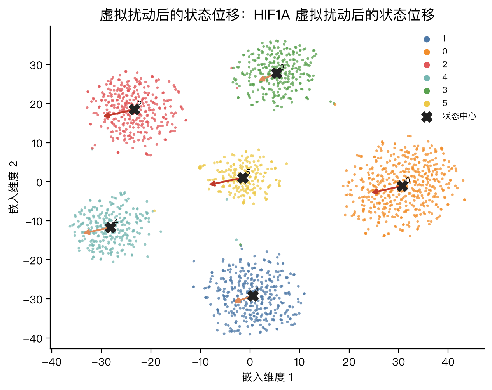

# dsh-virtualcell · 虚拟细胞工作台

> 一个装在 **DeepSeek Harness** 里的虚拟细胞（AI Virtual Cell, AIVC）工作台：
> 把单细胞表达谱变成**可以在电脑里做实验**的模型——敲掉一个基因，看细胞状态往哪边偏。

界面形态与操作逻辑与姊妹项目 [dsh-singlecell](../dsh-singlecell)（单细胞工作台）、[dsh-geobulk](../dsh-geobulk)（GEO/Bulk 工作台）一致：
**左栏流程卡 → 中间图表 → 右栏 Agent 面板**；页面上的每个按钮和对话里的 `virtualcell` 工具**走同一套实现**，
所以「点着用」和「让 Agent 干活」结果完全一致。



## 它解决什么问题

单细胞分析通常停在「分群 + 注释 + 差异基因」。虚拟细胞要回答的是下一步的问题：

- **敲掉这个转录因子，细胞会变成什么状态？**（虚拟敲除 / 敲低 / 过表达）
- **哪些调控因子最值得做实验？**（批量虚拟筛选，按"能把细胞推多远、推得多专一"排序）
- **如果我有 Perturb-seq 数据，建模能预测没做过的扰动吗？**（扰动响应预测，留一验证）
- **细胞状态之间谁流向谁？**（状态转移矩阵 + 稳定性）
- **这套推断有多可信？**（demo 自带真值网络：AUROC / 扰动 Δ 相关性 / 通过判定；真实数据给 Bootstrap 稳定性）

同时把三件"工程卫生"做进流程：

1. **原始数据保留**：导入即登记 sha256 + 复制副本（>2 GiB 只登记路径），永不修改输入；
2. **每次运行可回溯**：`runs/run-XXXX/` 里保存参数、结果、环境版本、上游输入哈希、表、图、日志（只增不改）；
3. **参数辅助调整**：每个参数都有**基于当前数据维度的推荐值 + 为什么 + 风险等级**，外加参数扫描挑最优。

## 功能一览

| 模块 | 内容 |
|---|---|
| **输入** | `.h5ad`、10x `.h5`、10x mtx 三件套、Loom、文本矩阵 csv/tsv/txt（可 gz，方向自动判断）、GEO series matrix、zip/tar 压缩包、URL；另可挂载扰动表 / 基因集 / GRN 先验 / 药物签名 |
| **质控** | 每细胞检出基因数 / 总 counts / 线粒体占比；可过滤细胞与低表达基因（掩码保留，可回溯） |
| **状态表征** | 归一化 + log1p → HVG（seurat 风格）→ PCA → kNN 图 → 聚类（自动扫 k / 指定 k；有 scanpy 则 Leiden）→ 2D 嵌入（t-SNE/UMAP/PCA）→ 每簇 marker |
| **状态注释** | 内置 20 类细胞状态参考 marker 面板，z-score / UCell 秩和打分，输出 top1/top2 + margin + 证据基因 |
| **调控网络** | 候选边 = 全局共表达 ∪ 簇内共表达（先验也可上传）× 每簇标准化 Ridge；输出有向边、按总权重排序的 hub TF、CV R²、方向性证据等级 |
| **网络校验** | demo 真值：边 AUROC / AUPRC / top-k 精准率 + 留出扰动的 Δ 相关性（Spearman/Pearson/Jaccard）+ 通过判定 |
| **虚拟扰动** | KO / knockdown / overexpression；沿网络迭代传播；投影到隐空间估状态位移；受影响基因排名；通路 ORA |
| **虚拟筛选** | 批量轻量扰动，按 `位移 × 专一性` 打分，输出候选靶点排名与目标状态 |
| **响应预测** | 有 Perturb-seq 样表 → 隐空间加性模型（GEARS-lite），留一/多折验证、与均值基线对比；无扰动表 → 药物/签名投影 |
| **状态转移** | kNN 邻接 + Sinkhorn 平滑的转移矩阵、源/汇状态、Bootstrap 稳定性 |
| **智能分析** | 结构化结论（细胞状态 / 调控结构 / 扰动与候选靶点 / 方法学局限 / 下一步）+ 自检 0–100 分 |
| **出图** | 16 种 200 dpi 出版级图：状态图、扰动箭头场、瀑布图、网络图、热图、筛选排名、响应散点、转移矩阵/流向、校验 ROC… |
| **留存 / 导出** | 不可变 `runs/` 记录；导出 `report.md` / `methods.md`（英文 Methods）/ `protocol.json` / `summary.json` / `script.py` / 各种 CSV / 单次运行 zip |
| **预设流程** | `quick`（快速体验）/ `standard`（标准）/ `full`（含响应预测）一键跑 |
| **可选后端** | scanpy / scVI / CellOracle / GEARS / scGPT / Geneformer / State（Arc）：装了就自动用，没装如实标注并降级，功能不缺失 |

## 安装

```bash
python3 -c "import numpy, pandas, scipy, sklearn, anndata, h5py, matplotlib; print('OK')"
# 缺包：python3 -m pip install -r requirements.txt
```

在 Harness 里：**设置 → 插件 → 安装本地插件包**，选择本目录；或让 Agent 调
`plugin_manager action=install_bundle target=<本目录绝对路径>`。重载页面后侧边栏出现「虚拟细胞」，对话里出现 `virtualcell` 工具。
详见 [INSTALL.md](INSTALL.md)。

## 快速上手（3 步）

1. 打开「虚拟细胞」→ 顶栏 **载入示例数据**（2000 细胞 × 1000 基因，147 个 TF，自带真值网络与 5 个留出扰动）；
2. 顶栏 **一键全流程 → 快速体验**：质控 → 状态表征 → 状态注释 → 调控网络 → 网络校验 → 虚拟敲除一个 hub TF → 智能分析；
3. 到「扰动」tab 换个基因再敲一次；到「智能分析」看候选靶点与方法学局限；到「记录」导出报告。

对话里也可以直接说：

```
用虚拟细胞工作台载入示例数据，跑一遍标准流程，然后敲除 RUNX3 看看细胞状态往哪偏
用虚拟细胞工作台导入 /path/to/data.h5ad，先质控+状态表征，再推断 GRN 并虚拟筛选靶点
用虚拟细胞工作台把 MYC 和 KLF4 都敲一次，比较哪个对状态影响更大，并导出报告
```

## 示例数据上能自证到什么程度

内置 demo 是**合成但有真值**的基准：真值网络 + 5 个留出 TF 的解析扰动 Δ + Perturb-seq 样表。
2000 细胞 × 1000 基因、默认参数下实测（本机 Python 3.14 / numpy 2.5）：

| 指标 | 数值 | 说明 |
|---|---|---|
| 状态数 / 注释 | 6 个状态，6/6 命中参考面板 | 聚类纯度按真值标签 100% |
| 边 AUROC / AUPRC | **0.985 / 0.958** | 在候选边空间内评估（computed on candidate pairs） |
| 留出扰动 Δ Spearman / Pearson | **0.81 / 0.90** | 模拟 Δ vs 真值 Δ（top-200 基因） |
| 校验判定 | **通过** | 阈值：AUROC ≥ 0.65 且 Δ Spearman ≥ 0.30 |
| 单步耗时 | 质控 ~10 s（含引擎启动）/ 状态表征 ~4 s / 网络 ~0.6–0.9 s / 扰动 ~0.2–0.4 s | Apple Silicon 本机 |
| 自检得分 | 90/100（standard 流程 10 步全绿） | 仅 2 条建议项（状态分离度、方向性证据） |

> 这些数字只说明**流程在信号明确的合成数据上是自洽的**，不代表真实数据也能达到。
> 真实数据上请先看 `audit` 与 `validity`：GRN 方向性证据通常是 `weak`（共表达没有因果方向），
> 虚拟扰动结论必须用 ATAC/ChIP 先验或 qPCR/WB/功能实验验证。

## 为什么可信度要写在结果里

虚拟敲除的数学很简单：`Δ ← Δ + Wᵀ·Δ_tf` 沿网络传播，再投影到隐空间看状态质心怎么动。
**它的全部可信度来自 GRN**。所以本工作台：

- 每条 GRN 结果都带 `validity.directional_evidence`（weak / moderate / strong）与文字说明；
- 每个扰动结果都带 `validity.notes`，明说"这是基于共表达 GRN 的假说"；
- `insight` 强制包含「方法学局限」小节，`audit` 会对"未校验""方向性弱""残差比过低"扣分；
- 有真值（demo）时才给 AUROC 这类"准确性"数字，真实数据只用 Bootstrap 稳定性替代。

## 目录与产物

```
~/.dsh/virtualcell/                       # 默认工作目录（插件配置 workdir 可改）
├─ state.json                             # 数据集登记、步骤摘要、附件
├─ datasets/ds1/
│  ├─ raw/manifest.json + 原始文件副本     # 原始数据保留（sha256/大小/来源/copy 标记）
│  ├─ bundle.h5ad                          # 解析后的统一矩阵（可与 scanpy/单细胞工作台互通）
│  ├─ stage/*.npz + *.json                 # 各步骤产物（worker 重启后可恢复）
│  └─ runs/run-0007/                       # 每次运行：params/result/env/inputs/log + tables/ + figures/
├─ exports/                                # 导出的报告、方法、协议、脚本、CSV
└─ engine.log
```

## Agent 工具

单一 `virtualcell` 工具覆盖全流程：

`status` `formats` `steps` `demo` `open` `inspect` `preview` `suggest` `run` `perturb` `screen`
`sweep` `plot` `attach` `export` `audit` `insight` `recipe` `runs` `reset`

典型调用路径：`status` → `demo`（或 `open`）→ `suggest` → `run{qc,state,annotate,grn,validate}`
→ `perturb{gene}` / `screen` → `audit` + `insight` → `export{report}`。

## 工程结构

```
dsh-virtualcell/
├─ index.js              # Host 入口：/virtualcell 路由 + 工具 + prompt section
├─ client.js             # 浏览器整页（React.createElement，无构建步骤）
├─ lib/engine.mjs        # Python worker 管理（探测/排队/超时/重启）
├─ lib/impl.mjs          # HTTP 路由 + Agent 工具（与 UI 同一套操作）
├─ lib/vc_engine.py      # worker 主循环：数据集、步骤编排、run 留存、自检/智能分析/导出
├─ lib/vc_io.py          # 输入解析 + 示例数据生成（含真值）
├─ lib/vc_state.py       # 质控 / 状态表征 / 注释 / 状态转移
├─ lib/vc_grn.py         # GRN 推断 / 校验 / 虚拟扰动 / 虚拟筛选
├─ lib/vc_response.py    # 扰动响应预测 + 签名投影
├─ lib/vc_plot.py        # 16 种出版级出图
├─ lib/vc_priors.py      # 参考 marker / TF 列表 / 通路基因集
├─ test/                 # node 单测 + 各模块自测 + 端到端冒烟测试
├─ CONTRACT.md           # 工程契约（路由/JSON/Python 签名）
└─ DESIGN.md             # 设计说明与算法
```

## 测试

```bash
node test/impl.test.mjs          # Host 纯逻辑（路径安全/错误映射/工具 schema）
node test/client-logic.test.mjs  # 前端纯函数
python3 test/test_io.py          # 输入解析 + demo 确定性
python3 test/test_state.py       # 状态表征 / 注释 / 转移
python3 test/test_grn.py         # GRN / 校验 / 扰动 / 筛选（合成真值 AUROC>0.9）
python3 test/test_plot.py        # 16 种图 + 降级路径
python3 test/smoke_e2e.py        # 端到端 42 项断言（含 worker 重启恢复）
```

## 参考

- Arc Institute **State** / Virtual Cell Challenge：扰动响应预测的评测范式（留出扰动、Turing test 思路）。
- Kamimoto et al., **CellOracle**（Nature 2023）：GRN + 扰动传播 + 状态位移。
- Roohani et al., **GEARS**（Nat Biotech 2023）：扰动响应的基因级预测与评测。
- scGPT / Geneformer / scFoundation：单细胞基础模型路线（本插件预留适配器位）。
- Replogle et al. Perturb-seq 图谱：扰动表格式参考。
- 生信技能树等中文社区对虚拟细胞（状态表征→GRN→虚拟扰动→响应预测→筛选）的拆解，以及其一贯的方法学提醒。

## 许可

MIT
